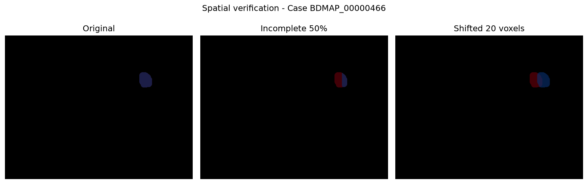

# IX.CT_reports-a-baseline-for-Report-generation-and-Claim-verification

Baseline cho bài toán tạo báo cáo CT có căn cứ từ segmentation và kiểm tra tính nhất quán của các nhận định.

Dự án được xây dựng để tìm hiểu hướng nghiên cứu **Grounded CT Reports, Across Hospitals (AIMA 2026 — Project IX)**, dựa trên ý tưởng segmentation-assisted report generation từ [RadGPT (Bassi et al., ICCV 2025)](https://openaccess.thecvf.com/content/ICCV2025/html/Bassi_RadGPT_Constructing_3D_Image-Text_Tumor_Datasets_ICCV_2025_paper.html).

Repo được triển khai theo một pipeline tối giản: đọc segmentation mask 3D → trích xuất đặc trưng → sinh báo cáo có cấu trúc → liên kết bằng chứng → kiểm tra volume và spatial consistency → đánh giá với các mask bị thay đổi có kiểm soát.

**Câu hỏi cho bài thực nghiệm:** *How do incomplete or spatially inaccurate segmentation masks affect the reliability of claim verification?*


## Mục lục

- [Chạy nhanh](#chạy-nhanh)
- [Kết quả](#kết-quả)
- [Pipeline](#pipeline)
- [Hướng dẫn chạy chi tiết](#hướng-dẫn-chạy-chi-tiết)
- [Dữ liệu và quy trình đánh giá](#dữ-liệu-và-quy-trình-đánh-giá)
- [Cấu trúc repo](#cấu-trúc-repo)
- [Xử lý sự cố](#xử-lý-sự-cố)
- [Hạn chế và hướng phát triển](#hạn-chế-và-hướng-phát-triển)
- [Tài liệu tham khảo](#tài-liệu-tham-khảo)

## Chạy nhanh

Thử nghiệm được thực hiện với Python 3.11 trên Windows, không yêu cầu GPU.

Cài đặt thư viện:

```powershell
python -m pip install -r requirements.txt
```

Tải archive segmentation mask từ AbdomenAtlas 3.0 Mini và đặt trong `data/raw/mask_only/` theo hướng dẫn ở phần dưới.

Chạy pipeline từ thư mục gốc:

```powershell
python src/prepare_sample.py
python src/inspect_real_mask.py
python src/generate_report.py
python src/verify_claims.py
python src/robustness_test.py
python src/spatial_verifier.py
```

Kết quả được lưu trong thư mục `results/`.

Nếu chỉ muốn xem lại thí nghiệm trên một mask mẫu đã được chuẩn bị, có thể bắt đầu từ `generate_report.py`.

## Kết quả

### 1. Dữ liệu thử nghiệm

| Thuộc tính | Giá trị |
|---|---|
| Dataset | AbdomenAtlas 3.0 Mini |
| Case ID | `BDMAP_00000466` |
| Mask | `liver_lesion.nii.gz` |
| Kích thước | 503 × 386 × 54 |
| Số voxel được đánh dấu | 4,773 |
| Tổng thể tích vùng tổn thương | 14.566 cm³ |

Thể tích trên là tổng thể tích được đánh dấu trong mask, không nhất thiết tương ứng với một khối u duy nhất.

### 2. Robustness & Verification

Ba điều kiện được thử nghiệm trên cùng một mask tham chiếu:

| Condition | Volume (cm³) | Dice | Centroid (mm) | Volume | Spatial | Combined |
|---|---:|---:|---:|---|---|---|
| Original | 14.566 | 1.0000 | 0.000 | PASS | PASS | PASS |
| Incomplete 50% | 7.285 | 0.6668 | 5.791 | FAIL | PASS | FAIL |
| Shifted 20 voxels | 14.566 | 0.2357 | 15.625 | PASS | FAIL | FAIL |

Các ngưỡng sử dụng:

- Volume tolerance: `0.01 cm³`
- Minimum Dice: `0.50`
- Maximum centroid distance: `10 mm`

Đây là những ngưỡng minh họa cho thí nghiệm lập trình, chưa được xác nhận về mặt lâm sàng.

### 3. Nhận xét

**Volume-only verification:** Khi mask được dịch chuyển 20 voxel, thể tích không thay đổi nên volume verifier vẫn PASS, dù Dice chỉ còn 0.2357.

**Spatial verification:** Việc bổ sung Dice và centroid distance giúp phát hiện trường hợp mask bị dịch chuyển so với vùng tham chiếu.

**Combined verification:** Bộ kiểm tra kết hợp đánh dấu cả hai trường hợp perturbation là FAIL, trong khi hai bộ kiểm tra riêng lẻ phản ứng khác nhau.

Kết quả cho thấy kiểm tra thể tích đơn thuần chưa đủ để đánh giá sự phù hợp về mặt không gian của bằng chứng segmentation.

Kết luận này chỉ áp dụng cho prototype và các perturbation được thử nghiệm, không chứng minh rằng RadGPT gặp cùng một hạn chế.

### 4. Visualization




Hình biểu diễn mask tham chiếu và mask được kiểm tra trên cùng một lát cắt.

## Pipeline

```text
AbdomenAtlas 3.0
       |
       v
3D Segmentation Mask (NIfTI)
       |
       v
Feature Extraction
  - Voxel count
  - Lesion volume
  - Bounding box
       |
       v
Structured Report Generation
       |
       v
Claim–Evidence Linking
       |
       v
+-----------------------+
| Claim Verification    |
|                       |
| Volume Consistency    |
| Spatial Consistency   |
+-----------------------+
       |
       v
Combined Verification
       |
       v
Robustness Analysis
  - Original mask
  - Incomplete mask
  - Shifted mask
```

Hệ thống sử dụng segmentation mask có sẵn, chưa thực hiện segmentation tự động từ CT gốc.

### Feature Extraction
Thể tích vùng được đánh dấu được tính bằng:

```math
V_{\mathrm{cm}^3} = \frac{N_{\mathrm{voxels}} \times V_{\mathrm{voxel,mm}^3}}{1000}
```

Trong đó:
- $N_{\mathrm{voxels}}$: Số voxel được đánh dấu trong mask.
- $V_{\mathrm{voxel,mm}^3}$: Thể tích của mỗi voxel (mm³).
- $V_{\mathrm{cm}^3}$: Tổng thể tích vùng được đánh dấu (cm³).

Thể tích mỗi voxel được tính dựa trên NIfTI affine.

### Structured Report Generation

Dữ liệu trích xuất được đưa vào template để tạo một báo cáo đơn giản.

Ví dụ từ ca thử nghiệm:

> Liver lesion annotation is present. Total segmented lesion volume: 14.566 cm3.

Thông tin bằng chứng được lưu trong JSON, bao gồm đường dẫn mask, bounding box và chỉ số lát cắt.

### Claim Verification

Volume verifier kiểm tra sự nhất quán về thể tích.

Spatial verifier so sánh mask đang kiểm tra với mask tham chiếu bằng Dice similarity và khoảng cách centroid theo đơn vị mm.

Các kiểm tra hiện tại hoạt động trên thuộc tính định lượng và mask có cấu trúc. Chúng chưa xác minh được mọi nhận định bằng ngôn ngữ tự nhiên trong báo cáo y khoa.

## Hướng dẫn chạy chi tiết

### 0. Yêu cầu

- Python 3.11
- NumPy, NiBabel, Matplotlib, Hugging Face Hub
- CPU là đủ cho các bước hiện tại
- Kết nối internet để tải dữ liệu lần đầu

### 1. Cài đặt

```powershell
python -m venv .venv
.\.venv\Scripts\Activate.ps1
python -m pip install -r requirements.txt
```

### 2. Chuẩn bị dataset

Dataset: [AbdomenAtlas 3.0 Mini](https://huggingface.co/datasets/AbdomenAtlas/AbdomenAtlas3.0Mini)

Archive được sử dụng:

`AbdomenAtlas3_masks_BDMAP_BDMAP_00000001_BDMAP_00000232.tar.tar.gz`

Có thể tải bằng:

```powershell
hf download AbdomenAtlas/AbdomenAtlas3.0Mini mask_only/AbdomenAtlas3_masks_BDMAP_BDMAP_00000465_BDMAP_00000696.tar.gz --repo-type dataset --local-dir data/raw
```

Sau đó chạy:

```powershell
python src/prepare_sample.py
```

Script tìm một mask tổn thương không rỗng trong archive và lưu ca mẫu vào `data/sample/`.

### 3. Đọc segmentation

```powershell
python src/inspect_real_mask.py
```

Đọc NIfTI, kiểm tra kích thước, số voxel, đơn vị không gian, tính tổng thể tích và lưu visualization.

### 4. Sinh Structured Report

```powershell
python src/generate_report.py
```

Đầu ra:

`results/sample_report.json`

Bao gồm thông tin ca, đặc trưng, báo cáo và metadata bằng chứng.

### 5. Volume Verification

```powershell
python src/verify_claims.py
```

Chương trình kiểm tra claim đúng, claim sai về thể tích và một thí nghiệm làm thiếu mask.

### 6. Robustness Experiment

```powershell
python src/robustness_test.py
```

So sánh mask gốc, mask bị xóa khoảng 50% voxel và mask dịch chuyển 20 voxel.

Đầu ra:

`results/robustness_results.json`

### 7. Spatial Verification

```powershell
python src/spatial_verifier.py
```

Tính Dice similarity, centroid distance và kết quả kết hợp volume–spatial.

Đầu ra:

`results/spatial_verification_results.json`

## Dữ liệu và quy trình đánh giá

### Dataset

AbdomenAtlas 3.0 được giới thiệu trong nghiên cứu RadGPT, cung cấp CT 3D, segmentation mask và báo cáo y khoa.

Trong phiên bản baseline này, chỉ sử dụng segmentation mask của tổn thương gan. Không sử dụng toàn bộ bộ dữ liệu và không tải CT gốc cho thí nghiệm hiện tại.

Dữ liệu được giữ cục bộ trong `data/` và không đưa trực tiếp lên GitHub.

### Experimental protocol

Thí nghiệm sử dụng mask gốc làm tham chiếu và tạo các phiên bản thay đổi có kiểm soát:

- **Original:** Giữ nguyên mask.
- **Incomplete:** Xóa khoảng 50% voxel được đánh dấu.
- **Shifted:** Tịnh tiến mask 20 voxel theo một trục, bảo toàn số voxel.

Các phép đo bao gồm lesion volume, Dice similarity và centroid distance.

Kết quả PASS/FAIL được xác định bằng các ngưỡng cố định. Đây là kiểm tra tính nhất quán với mask tham chiếu, không phải đánh giá độc lập về tính chính xác lâm sàng.

## Cấu trúc repo

```text
ct-report-grounding-baseline/
├── README.md
├── requirements.txt
├── .gitignore
├── src/
│   ├── grounding_demo.py
│   ├── prepare_sample.py
│   ├── inspect_real_mask.py
│   ├── generate_report.py
│   ├── verify_claims.py
│   ├── robustness_test.py
│   └── spatial_verifier.py
├── results/
│   ├── sample_report.json
│   ├── verification_results.json
│   ├── robustness_results.json
│   ├── spatial_verification_results.json
│   └── *.png
└── data/                 # Local only, Git ignored
```

`data/` không được đưa lên GitHub. Các file ảnh trong `results/` chỉ được chia sẻ nếu phù hợp điều kiện sử dụng dữ liệu.

## Xử lý sự cố

**Không tìm thấy archive:** Kiểm tra file `.tar.gz` có nằm trong `data/raw/mask_only/` hay không.

**Không tìm thấy mask:** Chạy lại `prepare_sample.py`, kiểm tra archive và thư mục `data/sample/`.

**ModuleNotFoundError:** Kích hoạt môi trường ảo và chạy `python -m pip install -r requirements.txt`.

**Không tìm thấy `sample_report.json`:** Chạy `generate_report.py` trước các bước verification.

**Cửa sổ Matplotlib chưa kết thúc:** Đóng cửa sổ hình để chương trình hoàn tất và trở lại terminal.

**Kết quả khác README:** Kiểm tra case ID, archive, mask, ngưỡng và các phép perturbation. Các script có thể chọn ca khác nếu dữ liệu đầu vào thay đổi.

## Hạn chế và hướng phát triển

### Hạn chế

- Chỉ đánh giá một ca có segmentation mask thật.
- Không huấn luyện hoặc chạy mô hình segmentation từ CT gốc.
- Báo cáo được sinh bằng template, không phải LLM/VLM.
- Verifier chỉ kiểm tra thông tin định lượng và vùng mask tham chiếu, chưa xử lý claim tự do.
- Thí nghiệm sử dụng perturbation nhân tạo, chưa mô phỏng đầy đủ lỗi segmentation thực tế.
- Các ngưỡng kiểm tra chưa được xác nhận lâm sàng.
- Chưa đánh giá trên dữ liệu từ nhiều bệnh viện.

### Hướng phát triển

- Đánh giá nhiều ca và nhiều loại tổn thương.
- Phân tích độ nhạy của các ngưỡng verification.
- Bổ sung những perturbation gần với lỗi segmentation thực tế.
- Tích hợp xử lý nhận định từ báo cáo do VLM sinh ra.
- Liên kết từng claim với vùng ảnh CT thực tế.
- Đánh giá độ tin cậy trên dữ liệu bệnh viện khác.

## Tài liệu tham khảo

**[1] Bassi, P. R. A. S., et al. (2025).**  
*RadGPT: Constructing 3D Image-Text Tumor Datasets.*  
Proceedings of the IEEE/CVF International Conference on Computer Vision (ICCV), pp. 23720–23730.

- Paper: https://openaccess.thecvf.com/content/ICCV2025/html/Bassi_RadGPT_Constructing_3D_Image-Text_Tumor_Datasets_ICCV_2025_paper.html
- Source code: https://github.com/MrGiovanni/RadGPT
- DOI: https://doi.org/10.1109/ICCV51701.2025.02202

**[2] AbdomenAtlas — AbdomenAtlas 3.0 Mini Dataset.**  
Hugging Face Datasets. Dataset được giới thiệu trong nghiên cứu RadGPT [1].

- Dataset: https://huggingface.co/datasets/AbdomenAtlas/AbdomenAtlas3.0Mini
- Mask-only files: https://huggingface.co/datasets/AbdomenAtlas/AbdomenAtlas3.0Mini/tree/main/mask_only
- License: CC BY-NC-SA 4.0

---

**Disclaimer:** Đây là prototype phục vụ học tập và nghiên cứu.
